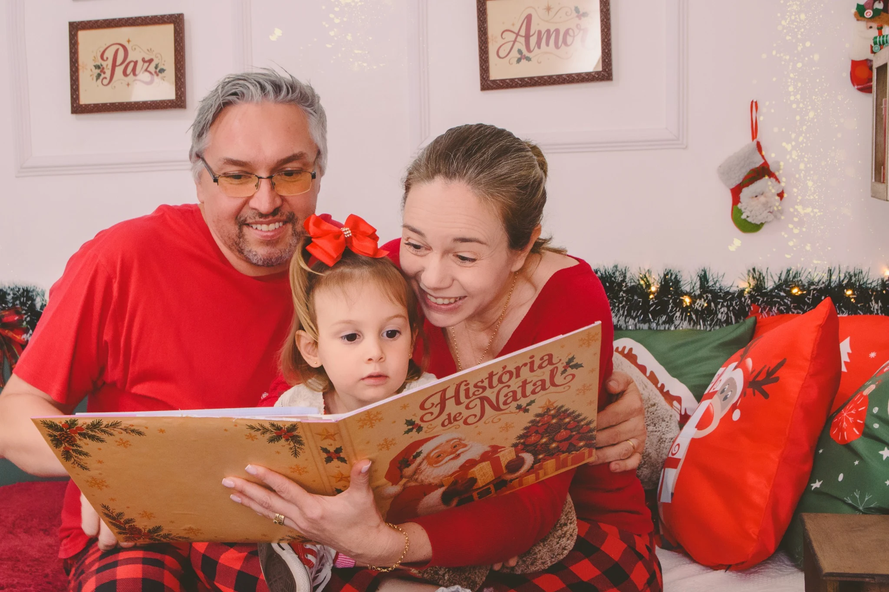

<div align="center">


# Fotografia que transforma momentos em memórias

**Marília Manzatto Furlan · Fotografia**

Um projeto front-end dedicado a contar histórias através de imagens, experiências visuais e movimento.


[Sobre](#sobre-o-projeto) · [Experiências](#duas-experiências-uma-identidade) · [Tecnologias](#tecnologias) · [Como executar](#como-executar) · [Autor](#autor)

---

</div>

## Sobre o projeto

Site de fotografia desenvolvido para apresentar o trabalho de **Marília Manzatto Furlan**, em Santa Bárbara d’Oeste — SP. A proposta une fotografias em destaque, tipografia expressiva e interações em JavaScript para valorizar ensaios de gestantes, newborn, família e acompanhamento infantil.

O repositório reúne uma página institucional e uma landing page especial de **Natal 2026**, cada uma com sua própria direção visual.

> “Histórias que merecem ser lembradas.”

## Duas experiências, uma identidade

| Página | Proposta visual | Conteúdo |
| :--- | :--- | :--- |
| **Fotografia** · `index.html` | Tons escuros, imagens em tela cheia e detalhes suaves | Ensaios, cenários, apresentação da fotógrafa, cards de artigos e contato |
| **Luz de Natal** · `natal.html` | Verde, dourado, vermelho e elementos decorativos natalinos | Apresentação do ensaio, diferenciais, pacotes, galeria, FAQ e formulário |

### Fotografia · histórias em primeiro plano

- **Carrossel manual na hero:** navegação entre cinco fotografias, com contador atualizado.
- **Vitrine de ensaios:** cards com efeitos de hover e categorias de fotografia.
- **Cabeçalho dinâmico:** mudança de fundo conforme a rolagem.
- **Menu para telas menores:** abertura e fechamento controlados por JavaScript.
- **Campo de busca expansível:** exibição do input ao clicar no ícone.
- **Layout com media queries:** adaptações na navegação e na grade de ensaios.

### Luz de Natal · uma experiência com movimento

- **Hero animada com GSAP e ScrollTrigger:** seção fixada durante a rolagem, zoom na imagem e transição entre textos.
- **Pacotes interativos:** alternância dos valores entre as opções “Valor regular” e “Domingo”.
- **Galeria de fotografias:** seleção de imagens dos ensaios natalinos.
- **FAQ expansível:** abertura e fechamento das respostas por clique.
- **Cards de pacotes adaptáveis:** reorganização da grade em telas menores.

<details>
<summary><strong>📷 Uma amostra das imagens utilizadas no projeto</strong></summary>

<br />

<table>
  <tr>
    <td width="50%"></td>
    <td width="50%"></td>
  </tr>
  <tr>
    <td align="center"><strong>Ensaios & histórias</strong></td>
    <td align="center"><strong>Luz de Natal · 2026</strong></td>
  </tr>
</table>

</details>

## Tecnologias

| Tecnologia | Aplicação no projeto |
| :--- | :--- |
| **HTML5** | Estrutura das páginas e organização das seções |
| **CSS3** | Flexbox, Grid, gradientes, transições, animações e media queries |
| **JavaScript** | Manipulação do DOM, eventos, carrossel, menu, seleção de preços e FAQ |
| **GSAP + ScrollTrigger** | Timeline vinculada à rolagem na página de Natal |
| **Vite** | Servidor de desenvolvimento, build e preview |
| **Remix Icon** | Ícones da interface carregados por CDN |
| **Google Fonts** | Fonte Dancing Script nos detalhes tipográficos |

As páginas carregam GSAP e ScrollTrigger por CDN. O pacote `gsap` também está declarado no `package.json`.

## Como executar

Tenha **Git**, **Node.js** e **npm** instalados. Para a compatibilidade exigida pelas dependências do lockfile, utilize Node.js **22.12 ou superior**.

### 1. Clone o repositório

```bash
git clone https://github.com/gmanzattodev/Fotografia.git
cd Fotografia
```

### 2. Instale as dependências e inicie o servidor

```bash
npm ci
npm run dev
```

Abra o endereço informado pelo Vite no terminal. Na configuração padrão:

| Experiência | Endereço local |
| :--- | :--- |
| Site principal | http://localhost:5173/ |
| Campanha de Natal | http://localhost:5173/natal.html |

Se a porta estiver ocupada, use a porta indicada no terminal. As bibliotecas por CDN, os ícones e as fontes precisam de conexão com a internet.

### Scripts disponíveis

| Comando | Função |
| :--- | :--- |
| `npm run dev` | Inicia o servidor de desenvolvimento |
| `npm run build` | Gera o build de produção em `dist/` |
| `npm run preview` | Serve o build gerado para conferência local |

**Build da campanha de Natal:** o repositório ainda não possui configuração de múltiplas entradas do Vite. A página `natal.html` pode ser acessada no desenvolvimento, mas sua inclusão no build de produção precisa ser configurada.

## Organização do código

| Caminho | Responsabilidade |
| :--- | :--- |
| `index.html` | Página institucional de fotografia |
| `natal.html` | Landing page de Natal 2026 |
| `public/logo.png` | Identidade visual |
| `src/assets/img/` | Fotografias do site principal |
| `src/assets/natal/` | Fotografias da campanha natalina |
| `src/assets/infeite/` | Elementos decorativos de Natal |
| `src/css/style.css` | Estilos do site principal |
| `src/css/responsividade.css` | Adaptações do site principal para telas menores |
| `src/css/natal.css` | Estilos e adaptações da campanha de Natal |
| `src/js/script.js` | Interações do site principal |
| `src/js/natal.js` | Animação, preços e FAQ da campanha |
| `src/js/cenarios.js` | Arquivo reservado para evolução da área de cenários |

## Em desenvolvimento

O projeto está em evolução. As interações descritas acima estão implementadas no código; alguns fluxos ainda precisam ser conectados ou refinados:

- Integrar o formulário a um serviço de envio e conectar as chamadas de agendamento e WhatsApp.
- Implementar a busca de conteúdo e o acesso aos artigos.
- Revisar as âncoras de navegação da campanha de Natal.
- Ampliar os ajustes de responsividade e acessibilidade.
- Desativar os marcadores de depuração do ScrollTrigger antes da publicação.
- Unificar o valor inicial do primeiro pacote no HTML com o valor aplicado pelo JavaScript.
- Configurar o build das duas páginas e revisar os caminhos das imagens para produção.

## Autor

Desenvolvido por **Giovani Manzatto**.

[](https://github.com/gmanzattodev)

## Licença

Este repositório contém a licença **MIT**. Consulte o arquivo [LICENSE](LICENSE) para os termos.

---

<div align="center">

**Cada ensaio é único, assim como a sua história.**

Fotografia · Memórias · Desenvolvimento front-end

</div>
